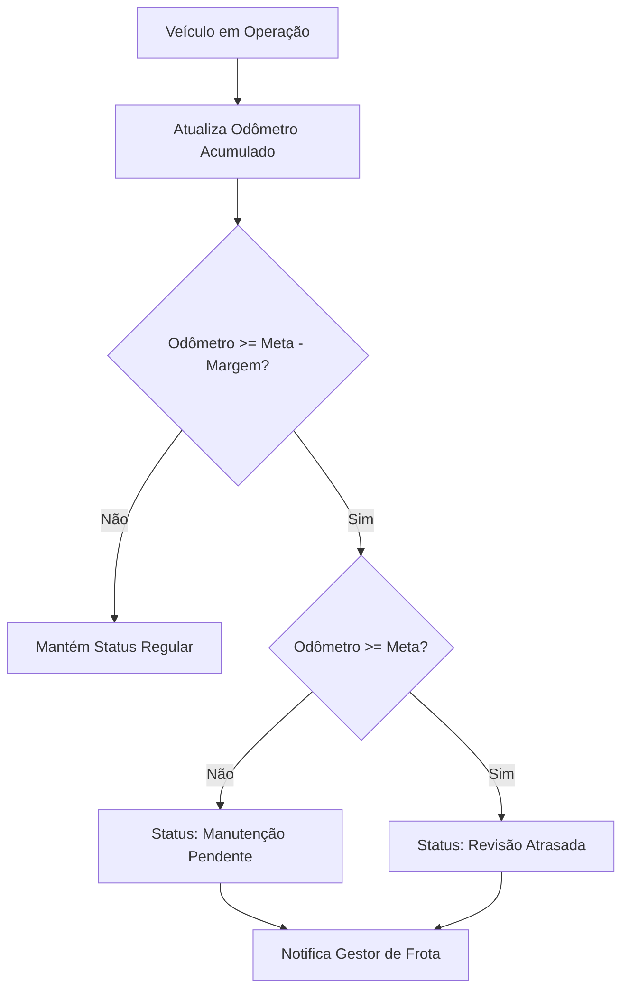

### 1. MAPA DE DOMÍNIOS

* **Telemetria e Rastreamento Operacional**  
  *Descrição:* Monitoramento contínuo da posição geográfica e do status operacional dos veículos em trânsito.  
  *Confiança:* **Alta** (necessidade central e consensual no diálogo).
* **Gestão de Segurança e Telemetria de Condução (Speeding)**  
  *Descrição:* Detecção de infrações de velocidade em trânsito e notificação em cabine/central.  
  *Confiança:* **Média** (falta definir parâmetros de limites de via, regras de tolerância e canais de notificação).
* **Manutenção Preventiva de Frota**  
  *Descrição:* Monitoramento de desgaste e alertas de intervenção preventiva (ex: troca de óleo) com base em uso/odômetro.  
  *Confiança:* **Média** (regras de cálculo preventivo/preditivo e gatilhos não foram aprofundados).
* **Segurança Patrimonial e Controle de Carga**  
  *Descrição:* Detecção de violação de baú/compartimento fora de perímetros homologados (geofencing) e atuação emergencial no veículo.  
  *Confiança:* **Baixa** (alto risco operacional e jurídico; mecanismo exato de bloqueio e hardware de travamento não detalhados).

---

### 2. MAPA DE STAKEHOLDERS

* **Carlos**
  * *Tipo:* Negócio / Operação (Gestor ou Operador de Central de Frota).
  * *Requisitos que defende:* Monitoramento de status além do mapa estático, alerta visual/sonoro imediato na cabine/painel para excesso de velocidade, avisos preditivos/preventivos de revisão para evitar quebra de motor, e bloqueio imediato do veículo em caso de violação de baú fora de geocercas autorizadas.
  * *Conflitos identificados:* Nenhum conflito entre múltiplos stakeholders (o diálogo é composto por Carlos e o Consultor facilitador). Há, contudo, um descompasso conceitual: Carlos pede "um toque antes de estourar o motor" e o Consultor traduz como "manutenção preditiva baseada em quilometragem", que na prática é preventiva baseada em odômetro. [VALIDAR COM EQUIPE].
* **Consultor (Facilitador/Analista)**
  * *Tipo:* Técnico / Analista.
  * *Requisitos que defende:* Estruturação de status de operação, alertas em tempo real e manutenção preventiva com base em quilometragem.

---

### 3. ESTRUTURA DE ÉPICOS

* **Épico 1: Telemetria e Alertas de Condução em Tempo Real**
  * *Descrição:* Monitoramento de velocidade do veículo e disparo de avisos na cabine e na central ao exceder limites.
  * *Complexidade:* **M** (Exige ingestão contínua de telemetria GPS/CAN bus, comparação de velocidade com limite parametrizado e emissão de alertas em baixa latência).
  * *Domínio:* Telemetria e Rastreamento Operacional / Gestão de Segurança.
* **Épico 2: Gestão de Manutenção Preventiva por Odômetro**
  * *Descrição:* Acompanhamento automático de quilometragem percorrida para emissão de alertas preventivos de troca de óleo e revisões.
  * *Complexidade:* **P** (Regra determinística de acumulação de odômetro vs. limiares estáticos de revisão cadastrados por veículo).
  * *Domínio:* Manutenção Preventiva de Frota.
* **Épico 3: Segurança de Carga e Atuação Remota por Geofencing**
  * *Descrição:* Monitoramento de sensores de abertura de portas de carga associados à cerca eletrônica, com capacidade de acionamento de bloqueio.
  * *Complexidade:* **GG** (Alto risco de segurança veicular em rodovias, integração crítica de atuadores de bloqueio, exigência de sensores de porta com protocolo seguro e conformidade regulatória).
  * *Domínio:* Segurança Patrimonial e Controle de Carga.

---

### 4. USER STORIES

#### Story 1: Alerta de Excesso de Velocidade
* **Card:** Como operador de despacho, quero visualizar alertas imediatos no painel da central quando um veículo ultrapassar o limite de velocidade configurado, para que eu possa atuar operacionalmente antes que ocorra um acidente ou infração.
* **Validação INVEST:**
  * *Independent:* **PASS** (Pode ser desenvolvida a partir do recebimento de telemetria de velocidade do rastreador).
  * *Negotiable:* **PASS** (Parâmetros de velocidade, tolerância e layout do alerta podem ser ajustados).
  * *Valuable:* **PASS** (Reduz riscos de acidentes e custos com multas).
  * *Estimable:* **PASS** (Escopo claro de consumo de dados e exibição de notificação).
  * *Small:* **PASS** (Cabe em 1 sprint de desenvolvimento).
  * *Testable:* **PASS** (Permite testar com envio de pacotes acima/abaixo do limiar).
* **Critérios de Aceite (Gherkin):**
  * *Cenário: Notificação de excesso de velocidade na central (Happy Path)*
    * Dado que o veículo possui limite de velocidade cadastrado de `[A CONFIRMAR COM STAKEHOLDER]` km/h
    * E o veículo está em trânsito com status operacional regular
    * Quando a central receber um evento de telemetria com velocidade superior ao limite cadastrado
    * Então o sistema deve exibir um alerta visual com status crítico na tela de monitoramento em até `[A CONFIRMAR COM STAKEHOLDER]` segundos
    * E registrar o evento no log de infrações com data, hora, veículo, motorista e velocidade aferida.
  * *Cenário: Velocidade normalizada após excesso (Edge Case)*
    * Dado que um alerta de excesso de velocidade está ativo para o veículo
    * Quando a central receber uma atualização com velocidade inferior ou igual ao limite configurado por `[A CONFIRMAR COM STAKEHOLDER]` leituras consecutivas
    * Então o status de alerta crítico deve ser encerrado no monitoramento ativo
    * E a duração total do evento de excesso deve ser gravada no histórico.
* **Dependências:** Sistema/dispositivo de rastreamento enviando pacote de telemetria com campo de velocidade calibrado.
* **Notas Técnicas:** O cliente mencionou "dar um grito no painel" do caminhão [ANTI-PADRÃO: RESULTADO NÃO VERIFICÁVEL]. Para alertar o motorista em cabine, é necessário atuador de buzzer/computador de bordo embarcado. A história acima cobre o painel da central operacional; a notificação embarcada depende de hardware específico.

---

#### Story 2: Alerta Preventivo de Troca de Óleo por Odômetro
* **Card:** Como gestor de frota, quero receber um alerta quando a quilometragem percorrida por um caminhão atingir a margem de antecedência da troca de óleo, para que eu possa agendar a manutenção antes que o motor sofra avaria mecânica.
* **Validação INVEST:**
  * *Independent:* **PASS** (Depende apenas do acúmulo de km/odômetro e do plano de manutenção).
  * *Negotiable:* **PASS** (Margens de tolerância de km podem ser negociadas).
  * *Valuable:* **PASS** (Evita quebras de motor e paradas não programadas).
  * *Estimable:* **PASS** (Lógica de contagem e comparação matemática simples).
  * *Small:* **PASS** (Cabe confortavelmente em 1 sprint).
  * *Testable:* **PASS** (Valida-se simulando incrementos de odômetro).
* **Critérios de Aceite (Gherkin):**
  * *Cenário: Geração de aviso de proximidade de revisão (Happy Path)*
    * Dado que o veículo tem uma meta de troca de óleo definida para a quilometragem `X`
    * E a margem de antecedência de alerta está configurada para `[A CONFIRMAR COM STAKEHOLDER]` km
    * Quando o odômetro acumulado do veículo atingir `X - margem`
    * Então o sistema deve marcar o veículo com status "Manutenção Pendente" na listagem da frota
    * E gerar uma notificação no painel do gestor de frota.
  * *Cenário: Veículo atinge quilometragem de revisão sem registro de manutenção (Edge Case)*
    * Dado que o veículo atingiu ou superou a quilometragem `X` sem registro de ordem de serviço concluída
    * Quando o sistema processar a atualização de odômetro
    * Então o status do veículo deve mudar para "Revisão Atrasada - Risco Crítico"
    * E o veículo deve ser destacado com sinalização visual de restrição na alocação de novas rotas.
* **Dependências:** Cadastro prévio de intervalos de manutenção dos veículos e recebimento consistente de odômetro (via CAN bus ou cálculo por GPS acumulado).
* **Notas Técnicas:** O stakeholder pediu "antes de dar algum problema sério" [ANTI-PADRÃO: VOZ PASSIVA SEM SUJEITO / TERMO SUBJETIVO]. Não há telemetria preditiva real (como análise de viscosidade ou sensores térmicos complexos); trata-se de manutenção preventiva baseada em regras determinísticas de odômetro.

---

#### Story 3: Bloqueio de Segurança por Abertura Indevida de Carga Fora de Geocerca
* **Card:** Como operador de segurança patrimonial, quero que o sistema detecte a tentativa de abertura de portas de carga fora dos pontos de entrega homologados e acione os mecanismos de bloqueio de segurança, para que seja impedido o furto ou desvio da carga em rota.
* **Validação INVEST:**
  * *Independent:* **PASS** (Pode ser tratada como um fluxo autônomo de eventos de violação).
  * *Negotiable:* **PASS** (Regras de temporização, confirmação humana e tipo de bloqueio podem ser ajustadas).
  * *Valuable:* **PASS** (Proteção direta do ativo financeiro/carga).
  * *Estimable:* **[INVEST-FAIL: Estimable]** - Carlos mencionou "tem que bloquear tudo na hora" [ANTI-PADRÃO: ESCOPO IMPLICITAMENTE INFINITO / AMBIGUIDADE]. Não está definido o que é "bloquear tudo" (corte de combustível, bloqueio de ignição em movimento, trava eletrônica do baú) nem a arquitetura de segurança viária. Bloquear caminhão em movimento em rodovia é ilegal e gera risco de colisão grave. A história não é estimável com precisão técnica sem esse alinhamento.
  * *Small:* **FAIL** (Envolve geofencing, barramento de hardware veicular, atuadores e redundância de telecomunicação).
  * *Testable:* **PASS** (Testável em bancada/homologação com telemetria simulada).
* **Critérios de Aceite (Gherkin):**
  * *Cenário: Detecção de violação fora do ponto de entrega homologado (Happy Path)*
    * Dado que o caminhão está localizado fora do perímetro de geocerca de entrega autorizado
    * E o sistema de monitoramento está armado para a viagem
    * Quando o sensor registrar sinal de abertura de porta da área de carga
    * Então o sistema deve acionar o alerta sonoro e visual de "Violação de Carga" no centro de controle em menos de `[A CONFIRMAR COM STAKEHOLDER]` segundos
    * E enviar o comando de trava eletrônica secundária [A CONFIRMAR MECANISMO COM ENGENHARIA].
  * *Cenário: Perda de conexão no momento da violação (Edge Case)*
    * Dado que o caminhão trafega em zona sem cobertura de sinal de dados (sombra de rede)
    * Quando ocorrer a abertura não autorizada do baú
    * Então a lógica embarcada no rastreador deve executar a diretiva local de contingência de segurança configurada
    * E transmitir o pacote prioritário de evento crítico imediatamente após recuperar a conexão móvel/satelital.
* **Dependências:** Sensores de abertura de portas instalados e calibrados; atuador veicular homologado; módulo de geofencing de rotas ativado.
* **Notas Técnicas:** O acionamento remoto de atuadores veiculares exige validação rigorosa de segurança operacional. Normas e gerenciadoras de risco exigem que bloqueio de ignição ou frenagem progressiva siga protocolos estritos para evitar acidentes fatais na via.

---

### 5. PERGUNTAS EM ABERTO

1. **Qual é o canal e o destinatário do "grito no painel" por excesso de velocidade?** O aviso deve ser sonoro/visual dentro da cabine do caminhão (exigindo buzzer/display veicular instalado) ou trata-se de um alerta sonoro e visual na aplicação web da central de monitoramento?  
   → *Impacto:* Se exigir hardware na cabine, há custo direto de hardware, instalação física na frota e tempo de homologação elétrica veicular.
2. **Qual é a fonte e a regra para os limites de velocidade?** Os limites serão fixos (ex: teto máximo de 80 km/h para toda a frota) ou dinâmicos baseados na velocidade da via através de mapa de geolocalização com base cartográfica (Mapbox/Google/OSM)?  
   → *Impacto:* Determina se o projeto precisa contratar e integrar serviços externos de geocodificação de vias ou apenas uma parametrização cadastral no banco de dados.
3. **O que significa tecnicamente "bloquear tudo na hora" em caso de abertura indevida de carga?** Refere-se à trava física do baú, impedimento de nova partida de motor com caminhão parado, corte de combustível ou alarme sonoro local?  
   → *Impacto:* Risco crítico de segurança do trabalho e responsabilidade civil/jurídica se um veículo for bloqueado enquanto trafega em alta velocidade.
4. **Qual é o tempo de resposta aceitável ("na hora") para o envio e processamento do comando de segurança?** Qual é a latência máxima permitida e qual a infraestrutura de rede disponível nas rotas (rede celular 4G/5G ou necessidade de contingência satelital)?  
   → *Impacto:* Define os requisitos de arquitetura de broker de mensageria (MQTT, WebSocket) e custos com conectividade híbrida satelital.
5. **Como a quilometragem para a manutenção é calculada hoje?** Os veículos possuem leitura direta de odômetro via barramento eletrônico (porta OBD-II / CAN J1939) ou a quilometragem deverá ser acumulada por cálculo vetorial de pontos de GPS?  
   → *Impacto:* Precisão do odômetro e risco de acionar manutenção preventiva fora do momento adequado se o GPS perder sinal.

---

### 6. FLAGS DE RISCO

* **[ESPECIFICAÇÃO INVENTADA]** — O tempo de latência de alerta, tolerâncias de velocidade e km de troca de óleo foram demarcados como `[A CONFIRMAR COM STAKEHOLDER]`. Qualquer valor numérico atribuído sem validação constituirá invenção de escopo.
* **[DEPENDÊNCIA NÃO MAPEADA]** — O mecanismo de bloqueio veicular e os sensores de porta do compartimento de carga dependem de hardware embarcado e chicote veicular não confirmados na infraestrutura atual.
* **[VIABILIDADE TÉCNICA SILENCIOSA]** — "Bloquear tudo na hora" pressupõe cobertura ininterrupta de sinal de telecomunicações nas estradas ou capacidade de processamento local no rastreador para tomada autônoma de decisão fora da cobertura celular.
* **[GOLD PLATING]** — O facilitador mencionou "manutenção preditiva", o que induz ao uso de inteligência artificial ou telemetria avançada de sensores automotivos que não foram contratados nem solicitados. O escopo deve se ater à manutenção preventiva parametrizada por odômetro.

---

### 7. CARDS PRONTOS PARA JIRA

---
**Épico:** Telemetria e Alertas de Condução em Tempo Real  
**Feature:** Alertas de Excesso de Velocidade  
**Título:** Como operador de despacho, quero visualizar alertas imediatos no painel da central quando um veículo ultrapassar o limite de velocidade configurado  
**Tipo:** Story  
**Story Points:** 5 — *Consumo de tópicos de telemetria, comparação contra limite em banco e renderização reativa na interface do operador.*  
**Sprint:** Sprint a definir  
**Component/s:** alertas-velocidade, telemetria-frontend  
**Labels:** telemetria, M  

**Para que:** atuar operacionalmente antes que ocorra um acidente ou infração de trânsito.

**Critérios de Aceite:**  
Cenário: Notificação de excesso de velocidade na central  
  Dado que o veículo possui limite de velocidade cadastrado de `[A CONFIRMAR COM STAKEHOLDER]` km/h  
  E o veículo está em trânsito com status operacional regular  
  Quando a central receber um evento de telemetria com velocidade superior ao limite cadastrado  
  Então o sistema deve exibir um alerta visual com status crítico na tela de monitoramento em até `[A CONFIRMAR COM STAKEHOLDER]` segundos  
  E registrar o evento no log de infrações com data, hora, veículo, motorista e velocidade aferida.

Cenário: Normalização de velocidade  
  Dado que um alerta de excesso de velocidade está ativo para o veículo  
  Quando a central receber leituras consecutivas com velocidade inferior ou igual ao limite por `[A CONFIRMAR COM STAKEHOLDER]` segundos  
  Então o status de alerta crítico deve ser encerrado no painel ativo  
  E o evento histórico deve consolidar a duração total do excesso.

**Dependências:** Pipeline de ingestão de telemetria GPS ativo e parametrizado.  
**Definition of Ready:** ⚠️ Pendente: Definição do SLA de latência máxima de notificação e regras de limite de velocidade da via.  
---

---
**Épico:** Gestão de Manutenção Preventiva por Odômetro  
**Feature:** Alertas de Revisão Preventiva  
**Título:** Como gestor de frota, quero receber um alerta quando a quilometragem percorrida por um caminhão atingir a margem de antecedência da troca de óleo  
**Tipo:** Story  
**Story Points:** 3 — *Cálculo de odômetro agregado via job assíncrono e flag visual de manutenção preventiva.*  
**Sprint:** Sprint a definir  
**Component/s:** manutencao-frota, agendamento-revisao  
**Labels:** manutencao, P  

**Para que:** agendar a manutenção antes que o motor sofra avaria mecânica por atraso de revisão.

**Critérios de Aceite:**  
Cenário: Notificação de proximidade de troca de óleo  
  Dado que o veículo possui plano de troca de óleo configurado para a quilometragem `X`  
  E a margem de alerta prévio configurada é de `[A CONFIRMAR COM STAKEHOLDER]` km  
  Quando o odômetro acumulado alcançar o valor de `X - margem`  
  Então o sistema deve alterar a flag de status do veículo para "Manutenção Pendente"  
  E notificar o gestor de frota na listagem de veículos.

Cenário: Limite de revisão atingido ou ultrapassado  
  Dado que o veículo alcançou a quilometragem `X` sem confirmação de ordem de serviço  
  Quando nova atualização de quilometragem for processada  
  Então o sistema deve alterar o status para "Revisão Atrasada" com sinalização vermelha de atenção.

**Dependências:** Módulo de cadastro de veículos com configuração de plano de manutenção e odômetro acumulado.  
**Definition of Ready:** ✅ INVEST validado  
---

---
[BLOQUEADA: Story "Bloqueio de Segurança por Abertura Indevida de Carga Fora de Geocerca" reprovada em [INVEST-FAIL: Estimable]. Requer detalhamento das diretrizes de segurança veicular, tipo físico de bloqueio a ser acionado e homologação do protocolo de atuadores embarcados antes da geração do card para desenvolvimento.]
---

---

### 8. DEPENDÊNCIAS NÃO DECLARADAS

1. **Protocolo e Conexão de Hardware Embarcado (Buzzer e Atuadores)** → Bloqueia a User Story 1 (Alerta sonoro na cabine) e Story 3 (Bloqueio do veículo) → *Ação:* Engenharia de hardware deve levantar a compatibilidade dos rastreadores instalados na frota para atuar sobre relés de bloqueio e acionamento sonoro em cabine.
2. **Provedor de Mapas e Camadas de Geocerca (Map API)** → Bloqueia a User Story 3 (Validação de local de entrega autorizado) → *Ação:* Contratação/homologação de serviço de mapas georreferenciados com API de cálculo de polígonos de geocerca em tempo real.
3. **Validação Jurídica e Normativa de Bloqueio Veicular em Trânsito** → Bloqueia a User Story 3 (Atuação emergencial em violação) → *Ação:* Jurídico e Engenharia de Riscos devem definir as regras operacionais (ex: bloqueio total apenas com caminhão parado e ignição desligada, ou ativação exclusiva de trava de baú) para evitar acidentes e infrações às normas de trânsito.

---

### 9. DIAGRAMA DE FLUXO (Mermaid)

#### Épico 1: Telemetria e Alertas de Velocidade
```mermaid
flowchart TD
    A[Veículo em Trânsito] --> B[Dispositivo GPS envia Pacote]
    B --> C{Velocidade > Limite?}
    C -- Não --> D[Atualiza Posição no Mapa]
    C -- Sim --> E[Gera Alerta Crítico na Central]
    E --> F[Dispara Alerta em Cabine [?]]
    E --> G[Operador de Despacho Recebe Notificação]
```

#### Épico 2: Gestão de Manutenção Preventiva por Odômetro


#### Épico 3: Segurança de Carga e Geofencing
```mermaid
flowchart TD
    A[Sensor de Porta] --> B[Detecção de Abertura de Baú]
    B --> C{Está dentro da Geocerca de Entrega?}
    C -- Sim --> D[Abertura Homologada / Operação Normal]
    C -- Não --> E[Dispara Alarme de Violação de Carga]
    E --> F[Notifica Central de Monitoramento]
    E --> G{Comando de Bloqueio Seguro [?]}
    G --> H[Atua Bloqueador Veicular [?]]
```

---

⚠️ Este output é um rascunho analítico. Requer revisão humana antes de entrar em sprint. Valide: viabilidade técnica, compliance/LGPD e dependências não mapeadas.